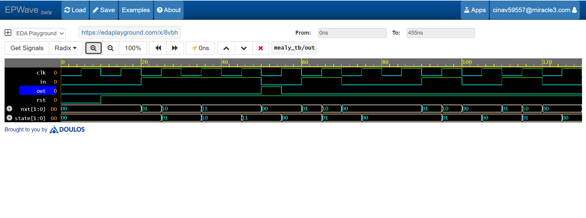

# Mealy FSM: `1110` Sequence Detector

RTL design and functional verification of a **Mealy Finite State Machine** implemented in **Verilog (`.v`)** to detect the serial bit sequence **`1110`**, simulated and verified on **EDA Playground**.

---

## Overview

In a **Mealy FSM**, the output depends on **both the current state and the current input**. This allows the FSM to detect the **`1110`** sequence using only **`4` states** and assert the output **immediately** within the same clock cycle that the final `0` arrives (one clock cycle earlier than a Moore machine).

* **Target Sequence:** `1110` (Overlapping)
* **Design Language:** Verilog (`.v`)
* **Simulator:** EDA Playground / EPWave

---

## State Transition Table

| Current State | Encoding (`state`) | Next State (`din = 0`) | Output (`din = 0`) | Next State (`din = 1`) | Output (`din = 1`) | Description |
| :--- | :---: | :---: | :---: | :---: | :---: | :--- |
| **S0 (IDLE)** | `2'b00` | `S0` | `0` | `S1` | `0` | Reset / initial state |
| **S1 (`1`)** | `2'b01` | `S0` | `0` | `S2` | `0` | Detected `1` |
| **S2 (`11`)** | `2'b10` | `S0` | `0` | `S3` | `0` | Detected `11` |
| **S3 (`111`)** | `2'b11` | `S0` | **`1`** | `S3` | `0` | Detected `111`; asserts `dout = 1` on `din = 0` |

---

## Simulation & Waveform

Verified on **EDA Playground** using **EPWave**:



### Key Waveform Observations
* Once the FSM reaches state `S3` (`111` detected), as soon as `din` transitions to `0`, `dout` asserts **HIGH (`1`)** combinationally before the next clock edge.
* On the following rising clock edge, the FSM returns to `S0` and `dout` drops back to `0`.

---

## Files & How to Run

```text
├── mealy_1110.v            # Verilog RTL design
├── mealy_1110_tb.v         # Verilog testbench
├── mealy seqvence detector/
│   └── waveform.png
└── README.md
